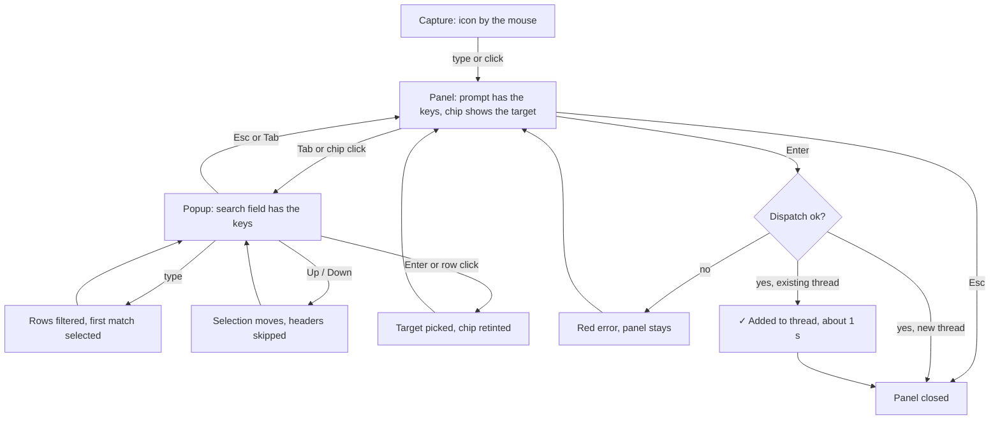

# Rework the ShotPrompt thread picker into a search popup with a remembered target

**Goal:** Rework the ShotPrompt thread picker into a search popup with a remembered target
**Status:** in_progress
**Created:** 2026-11-26
**Execution:** Use `/execute-plan-md <path-to-this-file>` to run this plan task-by-task.

---

## Architecture

The NSPopUpButton project menu in the prompt panel is replaced by a searchable popup (open threads first, then projects) and a tinted target chip. All choices (filtering, word matching, project short-list, relative time, last-target expiry, key handling, labels) are pure functions in ShotPromptCore with tests at 100% line coverage; main.swift only builds the windows and applies results. Settled in the /grill-me session of 2026-11-26 (12 decisions).

---

## Phase 1: Core decisions (pure, additive, TDD)

Ground rules for all three phases (repo: `/Users/aliirani/.t3/worktrees/shot-prompt/t3-cbe7ee02-e1ad3628e96a5398`, branch `t3/inject-screenshot-existing-thread`, PR #21):

- `swift test` also compiles `Sources/ShotPrompt/main.swift`. Phase 1 is therefore additive only: new functions, new enum cases with defaulted parameters, no renames or removals. Old API (`statusHint`, `statusLayout`, `threadEntries`, `returnToPID`) is deleted in Phase 2, in the same task that stops `main.swift` from calling it.
- TDD in Swift: "red" is a compile error (`cannot find 'x' in scope`) or a failing assertion. Run the named filter, see it red, implement, see it green, then refactor.
- New Core code goes in a new file `Sources/ShotPromptCore/TargetPicker.swift` with tests in a new `Tests/ShotPromptCoreTests/TargetPickerTests.swift`, unless a task names another file. Every Core line needs a test: `scripts/coverage.sh` must end with `coverage: 100.00% >= 100%`.
- `main.swift` only applies Core results. If a shell step needs an `if` that decides behaviour, move it to Core first.

### Task 1.1: Thread activity time and the relative-time label
**Files:** Modify: `Sources/ShotPromptCore/Projects.swift`, `Tests/ShotPromptCoreTests/ProjectTests.swift`; Create: `Sources/ShotPromptCore/TargetPicker.swift`, `Tests/ShotPromptCoreTests/TargetPickerTests.swift`
- [x] Write failing tests. In `ThreadTests`: a thread with `updated: "2026-03-01T10:00:00.500Z"` loads with `updatedAt == parseT3Date("2026-03-01T10:00:00.500Z")` (not nil); the existing fixtures with `"2026-01-01"` load with `updatedAt == nil` (existing equality assertions must still pass). In `TargetPickerTests`: `parseT3Date` accepts `"2026-11-26T17:52:59.621Z"` and `"2026-11-26T17:52:59Z"`, returns nil for `"2026-01-01"` and `""`. `relativeTime`: 0 s and 59 s give `"now"`, 60 s `"1m"`, 59 min 59 s `"59m"`, 3600 s `"1h"`, 23 h `"23h"`, 24 h `"1d"`, 10 days `"10d"`, a time 30 s in the future `"now"`. `threadDetail`: `"app · 2m"`, and `"app"` when `updatedAt` is nil.
- [x] Run `swift test --filter 'ThreadTests|TargetPickerTests'` and see it fail to compile.
- [x] Implement:
  - `OpenThread` gets `public let updatedAt: Date?`; `init(id:title:project:updatedAt: Date? = nil)` so existing call sites compile.
  - `loadThreads` selects a fourth column `coalesce(t.updated_at, '')` (keeps the "every column has text" rule and the row filter unchanged) and sets `updatedAt: parseT3Date(text(3))`.
  - `public func parseT3Date(_ text: String) -> Date?` (ISO 8601, with fractional seconds first, then without).
  - `public func relativeTime(from date: Date, now: Date) -> String` (`now`, `Nm`, `Nh`, `Nd`; negative ages count as 0).
  - `public func threadDetail(_ thread: OpenThread, now: Date) -> String` (`"<project> · <relativeTime>"`, or just the project).
- [x] Verify: `swift test --filter 'ThreadTests|TargetPickerTests'` → all pass, 0 failures.
- [x] Commit: `Load thread activity time and format it as time ago`

### Task 1.2: Word search
**Files:** Modify: `Sources/ShotPromptCore/TargetPicker.swift`, `Tests/ShotPromptCoreTests/TargetPickerTests.swift`
- [x] Write failing tests for `matchesQuery`: empty and whitespace-only queries match everything; `"shot fix"` matches fields `["Fix the picker", "shot-prompt"]` (words in different fields, any order); `"SHOT"` matches `"shot-prompt"`; `"rompt"` matches (anywhere in a word); `"shot zzz"` does not match.
- [x] Run `swift test --filter TargetPickerTests`, see red.
- [x] Implement `public func matchesQuery(_ query: String, fields: [String]) -> Bool`: split the query on whitespace, lowercase; every word must be contained in the lowercased fields joined with `"\n"`.
- [x] Verify: `swift test --filter TargetPickerTests` → pass.
- [x] Commit: `Match typed words anywhere in a title or project name`

### Task 1.3: Popup rows, selection and keys
**Files:** Modify: `Sources/ShotPromptCore/TargetPicker.swift`, `Sources/ShotPromptCore/Decisions.swift`, `Sources/ShotPromptCore/Layout.swift`, `Sources/ShotPrompt/main.swift` (one placeholder line), `Tests/ShotPromptCoreTests/TargetPickerTests.swift`, `Tests/ShotPromptCoreTests/DecisionTests.swift`, `Tests/ShotPromptCoreTests/LayoutTests.swift`
- [x] Write failing tests (build entries with `pickerEntries(projects:defaultRoot:)` over 8 projects):
  - `popupRows`, empty query: `.header("Add to an open thread")`, one `.item` per thread (`target: .thread(id:)`, `title` = full thread title, `detail` = `threadDetail`, `toolTip` = `"<title> · <project>"`), `.header("New thread in")`, then exactly 5 project items (`target: .newThread(root:)`, `title` = entry name, `detail` = `""`, `toolTip` = entry toolTip).
  - Project order: detected root first, then the default (entries' first), then the current target's project when the current target is a project, then the remaining entries in their order; no duplicates (detected == default still gives 5 distinct rows); `detectedRoot: nil` puts the default first.
  - With a query: every matching project is listed (more than 5 possible), in the same priority order (detected, default, current) and then the rest in entry order (test the order), matched on `[entry.name, folder name of entry.root]`; threads are matched on `[title, project]`; a section with no rows has no header; nothing at all gives `[.header("No match")]`. No threads gives only the "New thread in" section.
  - `popupSelection(rows, current:)`: index of the item whose target equals `current`; the first item when `current` is nil or not listed; nil when there are no items.
  - `movedSelection(rows, from:by:)`: +1/-1 skip headers; stays put at either end; from nil goes to the first item; nil when there are no items.
  - `popupTarget(rows, at:)`: the item's target; nil for nil, a header, or an index out of range.
  - `popupCommand`: `"moveUp:"` → `.up`, `"moveDown:"` → `.down`, `"insertNewline:"` → `.pick`, `"cancelOperation:"`, `"insertTab:"`, `"insertBacktab:"` → `.close`, anything else → `.none`.
  - `keyAction(isOurs: true, isEscape: true, commandOrControl: false, onIcon: false, popupOpen: true)` → `.closePopup`; with `popupOpen: false` → `.dismiss`; non-Esc keys with `popupOpen: true` → `.pass`; existing calls without the argument behave as before.
  - `chipClickToggles(closedAt:now:)`: true for nil and for a close 1 s ago; false for a close 0.1 s ago. `popupReopenGuardSeconds == 0.3`.
  - `popupHeight`: 2 headers + 3 items → `34 + (2*22 + 3*24) + 8 = 158`; no rows → 42; 20 items → `34 + 420 + 8 = 462` (the list caps at 420, which fits the unfiltered 2 headers + 15 items = 404 without scrolling).
  - `popupFrame(panel: CGRect(x: 100, y: 500, width: 420, height: 84), height: 200, visible: CGRect(x: 0, y: 0, width: 1440, height: 900))` → `CGRect(x: 100, y: 296, width: 420, height: 200)`; the same with panel `y: 150` → above the panel: `CGRect(x: 100, y: 238, width: 420, height: 200)`.
- [x] Run `swift test --filter 'TargetPickerTests|DecisionTests|LayoutTests'`, see red.
- [x] Implement in `TargetPicker.swift`:
  - `public struct PopupItem: Equatable { public let target: SendTarget; public let title: String; public let detail: String; public let toolTip: String }`
  - `public enum PopupRow: Equatable { case header(String); case item(PopupItem) }`
  - `public let maxPopupProjects = 5`
  - `public func popupRows(threads: [OpenThread], entries: [PickerEntry], detectedRoot: String?, current: SendTarget, query: String, now: Date) -> [PopupRow]`
  - `public func popupSelection(_ rows: [PopupRow], current: SendTarget?) -> Int?`
  - `public func movedSelection(_ rows: [PopupRow], from index: Int?, by delta: Int) -> Int?`
  - `public func popupTarget(_ rows: [PopupRow], at index: Int?) -> SendTarget?`
  - `public enum PopupCommand: Equatable { case up, down, pick, close, none }` and `public func popupCommand(_ selector: String) -> PopupCommand`
  - `public let popupReopenGuardSeconds: TimeInterval = 0.3` and `public func chipClickToggles(closedAt: Date?, now: Date) -> Bool` (a click on the chip first takes the keys from the popup, which closes it; the same click must not open it again)
- [x] Implement in `Decisions.swift`: add `case closePopup` to `KeyAction` and a trailing `popupOpen: Bool = false` parameter to `keyAction`; Esc returns `.closePopup` when `popupOpen`, else `.dismiss`. (`main.swift`'s switch over `KeyAction` needs a `case .closePopup: return event` placeholder so it still compiles; Task 2.3 replaces it.)
- [x] Implement in `Layout.swift`: `public enum PopupMetrics { rowHeight = 24, headerHeight = 22, searchHeight = 34, maxListHeight = 420, padding = 8, gap = 4 }`, `public func popupHeight(_ rows: [PopupRow]) -> CGFloat`, `public func popupFrame(panel: CGRect, height: CGFloat, visible: CGRect) -> CGRect` (under the panel with `gap`; above it when the bottom would pass `visible.minY + 8`; finally `clamp` it into `visible` so it never leaves the screen).
- [x] Verify: `swift test --filter 'TargetPickerTests|DecisionTests|LayoutTests'` → pass; `swift build` → `Build complete!`.
- [x] Commit: `Build the target popup's rows, selection and key commands`

### Task 1.4: Remembered target and target resolution
**Files:** Modify: `Sources/ShotPromptCore/TargetPicker.swift`, `Tests/ShotPromptCoreTests/TargetPickerTests.swift`
- [x] Write failing tests:
  - `lastTargetMinutes`: nil → 15; `30` (Int) → 30; `NSNumber(value: 5)` → 5; `"60"` (a launch argument) → 60; `0` and `"0"` → 0; `-3` → 0; `"abc"` → 15. `lastTargetChoices == [0, 5, 15, 30, 60]`. `lastTargetLabel(0) == "Off"`, `lastTargetLabel(15) == "15 min"`.
  - `rememberedTarget`: nil when `last` is nil; nil when `minutes == 0`; a thread used 14 min ago and still in `threads` is returned with `minutes: 15`; the same at 15 min exactly is nil; a thread no longer in `threads` is nil; a project root in `entries` is returned; a project root not in `entries` is nil.
  - `resolveTarget`: `picked` wins over everything; then `remembered`; then `.newThread(root: detectedRoot)`; then `.newThread(root: entries.first!.root)`; with empty `entries`, `.newThread(root: defaultRoot)`.
- [x] Run `swift test --filter TargetPickerTests`, see red.
- [x] Implement:
  - `public let lastTargetMinutesKey = "lastTargetMinutes"`, `public let lastTargetDefaultMinutes = 15`, `public let lastTargetChoices = [0, 5, 15, 30, 60]`
  - `public func lastTargetMinutes(_ stored: Any?) -> Int` (Int, NSNumber or digit string; negative → 0; missing or unreadable → 15)
  - `public func lastTargetLabel(_ minutes: Int) -> String`
  - `public struct LastTarget: Equatable { public let target: SendTarget; public let at: Date; public init(target: SendTarget, at: Date) }`
  - `public func rememberedTarget(_ last: LastTarget?, minutes: Int, now: Date, threads: [OpenThread], entries: [PickerEntry]) -> SendTarget?`
  - `public func resolveTarget(picked: SendTarget?, remembered: SendTarget?, detectedRoot: String?, entries: [PickerEntry], defaultRoot: String) -> SendTarget`
- [x] Verify: `swift test --filter TargetPickerTests` → pass.
- [x] Commit: `Remember the last target for a set time and resolve the starting target`

### Task 1.5: Chip, hint, status layout and send outcome
**Files:** Modify: `Sources/ShotPromptCore/TargetPicker.swift`, `Sources/ShotPromptCore/Layout.swift`, `Tests/ShotPromptCoreTests/TargetPickerTests.swift`, `Tests/ShotPromptCoreTests/LayoutTests.swift`
- [x] Write failing tests:
  - `cutTitle`: a short title is unchanged; a title of `threadTitleChars + 5` characters comes back `threadTitleChars` long and ends with `"…"`.
  - `targetChip(.thread(id: "1"), …)` → `label: "→ Fix the picker"`, `toThread: true`, `toolTip: "Adds to: Fix the picker · app (Tab to change)"`; an id not in `threads` → `label: "→ thread"`. `targetChip(.newThread(root: "/w/a"), …)` → `label: "+ A"` (the entry name), `toThread: false`, `toolTip: "New thread in /w/a (Tab to change)"` (the entry toolTip); a root not in `entries` → `"+ <last path component>"`.
  - `targetHint(hasPicker: true) == "↩ send · ⇥ change"`, `targetHint(hasPicker: false) == "↩ new T3 thread · esc dismiss"`.
  - `targetLayout(containerWidth: 420, labelWidth: 60.2, hintMinX: 104, hintWidth: 110)` → `chipFrame: CGRect(x: 331, y: 9, width: 77, height: 20)`, `hintWidth: 219`. `labelWidth: 500` → chip width 186 and `hintWidth: 110` (the hint keeps its full width). `labelWidth: 500, hintWidth: 600` (a long error) → chip width 60, `hintWidth: 236`. `targetLayout(containerWidth: 100, labelWidth: 60.2, hintMinX: 104, hintWidth: 110)` → chip width 60, `hintWidth: 0` (never negative).
  - `sendOutcome(ok: false, output: "boom", …)` → `.failure("failed: boom")`; ok with `.newThread` → `.close`; ok with `.thread(id:)` in `threads` → `.notice("✓ Added to <cut title>")`; ok with an unknown id → `.notice("✓ Added to thread")`. `addedNoticeSeconds == 1`.
- [x] Run `swift test --filter 'TargetPickerTests|LayoutTests'`, see red.
- [x] Implement in `TargetPicker.swift`:
  - `public func cutTitle(_ title: String, to chars: Int = threadTitleChars) -> String`
  - `public struct TargetChip: Equatable { public let label: String; public let toThread: Bool; public let toolTip: String }`
  - `public func targetChip(_ target: SendTarget, threads: [OpenThread], entries: [PickerEntry]) -> TargetChip`
  - `public func targetHint(hasPicker: Bool) -> String`
  - `public let addedNoticeSeconds: TimeInterval = 1`
  - `public enum SendOutcome: Equatable { case close; case notice(String); case failure(String) }`
  - `public func sendOutcome(ok: Bool, output: String, target: SendTarget, threads: [OpenThread]) -> SendOutcome`
- [x] Implement in `Layout.swift`: `public enum TargetChipMetrics { height = 20, padding = 16, minWidth = 60, gap = 8 }`, `public struct TargetLayout: Equatable { public let chipFrame: CGRect; public let hintWidth: CGFloat }`, `public func targetLayout(containerWidth: CGFloat, labelWidth: CGFloat, hintMinX: CGFloat, hintWidth: CGFloat) -> TargetLayout`. Formula: `right = containerWidth - 12`; `want = ceil(labelWidth) + padding`; `room = right - hintMinX - ceil(hintWidth) - gap`; `w = min(want, max(room, minWidth))`; chip at `x: right - w, y: 9`; returned `hintWidth = max(right - w - hintMinX - gap, 0)`.
- [x] Verify: `swift test --filter 'TargetPickerTests|LayoutTests'` → pass.
- [x] Commit: `Add the target chip, the short hint and the send outcome`

### Verification
- [x] `scripts/coverage.sh` ends with `coverage: 100.00% >= 100%` and lists `TargetPicker.swift` with 0 missed lines.
- [x] `swift build -c release --product ShotPrompt` → `Build complete!` (the shell still compiles and still uses the old menu).
- [x] `git diff 20b1392 --stat -- Sources/ShotPrompt/main.swift` shows only the one-line `.closePopup` placeholder.

## Phase 2: AppKit shell (chip, popup, memory, confirmation)

Shell tasks have no unit tests. Each ends with `swift build -c release --product ShotPrompt` plus a named live check on the fixture from Task 2.1. Take the screen lease once before the first live check (`screen-lease request --est 60m --why "ShotPrompt popup live checks"`, see `~/.claude/conventions/visual-verification.md`, "Which display"), keep the pointer and the panel on the built-in laptop display, and release the lease after the last check of the session.

### Task 2.1: Fixture database and live-run command
**Files:** Create (outside the repo, in a scratch folder `$S`): `$S/make-fixture.sh`, `$S/fixture.sqlite`, `$S/projects/*`, `$S/caps/`, `$S/neutral.png`
- [x] Write `make-fixture.sh`: it creates 8 empty folders under `$S/projects/` (invented names such as `notes`, `web-shop`, `blog`, `cli-tool`, `ios-app`, `docs`, `infra`, `playground`) and an SQLite file with the two tables from `ThreadTests.schema` in `Tests/ShotPromptCoreTests/ProjectTests.swift` (`projection_projects`, and `orchestration_v2_projection_threads` with `thread_id, project_id, title, updated_at, archived_at, deleted_at, payload_json`). Insert the 8 projects (one pinned) and 12 threads with invented titles, `payload_json = '{}'`, and `updated_at` values 1 minute to 3 days before now in the form `2026-11-26T17:52:59.621Z` (UTC, from `date -u`). One thread gets `{"settledAt":"2026-01-02"}` so it must not show.
- [x] Create `$S/neutral.png` (a plain shape on a flat colour, e.g. with `sips` or a screenshot of an empty TextEdit window): no personal or work data.
- [x] Create `$S/projects/blog/draft.txt` (two invented lines) and open it in TextEdit on the laptop display. TextEdit with this document in front is the "stock app" for every live check: its file path makes `blog` the detected project (`matchProject`, by path). A debug binary started from the T3 session's shell has T3's Accessibility grant, which the detection needs.
- [x] Live-run command, used by every later live check (change only the dispatch binary and the launch arguments):
  ```bash
  swift build && SHOT_PROMPT_CAPTURE_DIR=$S/caps SHOT_PROMPT_T3_DB=$S/fixture.sqlite SHOT_PROMPT_CWD=$S/projects/notes SHOT_PROMPT_DISPATCH=/usr/bin/false .build/debug/ShotPrompt -showMenuBarIcon NO
  ```
  A capture is `cp $S/neutral.png $S/caps/SCR-$(date +%s).png` with TextEdit in front and the pointer on the laptop display. Open the panel with `cliclick kp:space` (never a real letter first). Tab by script was flaky on the old menu; when `cliclick kp:tab` does nothing, click the chip (it opens the same popup). If keys still do not arrive, hand the key presses to Codex computer use (Ali's routing, with the laptop-display rectangle in the brief), and ask Ali only after that fails.
  The File chip shows the document's path, and `$S` may hold a user name: add `-contextURL NO` to the launch arguments for every run that is captured for the PR. The project is still detected with it off (the window is read either way).
- [x] Verify: `sqlite3 $S/fixture.sqlite "select count(*) from orchestration_v2_projection_threads"` → `12`; running the command above on the current commit and dropping a capture shows the icon, and the old picker menu lists 10 fixture threads and the fixture projects only.
- [x] Commit: none (scratch files outside the repo).

### Task 2.2: Target state and the tinted chip (decisions 9, 10, 11)
**Files:** Modify: `Sources/ShotPrompt/main.swift`, `Sources/ShotPromptCore/Projects.swift`, `Sources/ShotPromptCore/Layout.swift`, `Sources/ShotPromptCore/Decisions.swift`, `Tests/ShotPromptCoreTests/ProjectTests.swift`, `Tests/ShotPromptCoreTests/LayoutTests.swift`, `Tests/ShotPromptCoreTests/DecisionTests.swift`
- [x] In `Controller`, replace the picker state: delete `picker: NSPopUpButton?`, `returnTo`, `pickedByHand`, the computed `target`, `isThread`, `makePicker`, `openPicker` and `pickedProject`. Add `private var gear: NSButton?` (set in `expand()` where the gear is built, cleared in `dismiss()`), `private var threads: [OpenThread] = []`, `private var entries: [PickerEntry] = []`, `private var target: SendTarget = .newThread(root: config.threadCwd)`, `private var picked: SendTarget?`, `private var detectedRoot: String?`, `private var chip: NSButton?`. Keep `menuOpen`, `menuObservers` and `holdOpen`: the gear still opens an `NSMenu`.
- [x] In `expand()`: load `projects` and `threads = loadThreads(databasePath: config.t3Database)` once; `entries = pickerEntries(projects: projects, defaultRoot: config.threadCwd)`; the picker exists when `!projects.isEmpty || !threads.isEmpty`. When it exists, add the chip: a borderless `NSButton` with `wantsLayer`, corner radius 10, font 11 pt medium, `lineBreakMode = .byTruncatingTail`, `refusesFirstResponder = true`, action `#selector(chipClicked)`. The status label starts as `targetHint(hasPicker:)`.
- [x] Add `private func retarget()`: `target = resolveTarget(picked: picked, remembered: nil, detectedRoot: detectedRoot, entries: entries, defaultRoot: config.threadCwd)` (Task 2.4 fills `remembered`); `let c = targetChip(target, threads: threads, entries: entries)`; set the chip's title and toolTip; tint from `c.toThread`: blue (`NSColor.systemBlue` text on `systemBlue` at 0.2 alpha) or grey (`secondaryLabelColor` text on `labelColor` at 0.1 alpha); then `layoutStatus()`. It also runs from `readContext` before the panel exists, so use optional chaining on `chip` (with empty `entries` it resolves to `defaultRoot`, which is fine).
- [x] `applyContext()` becomes: `layoutChips()`, then `detectedRoot = autoProject ? window.flatMap { matchProject($0, serverFolder: serverFolder, projects: projects) } : nil`, then `retarget()`.
- [x] `layoutStatus()` measures the chip title and the current status string with their fonts and applies `targetLayout(containerWidth:labelWidth:hintMinX:hintWidth:)` (`chip.frame = chipFrame`, `status.frame.size.width = hintWidth`). Call it again wherever the status string changes (the `full` message, `sending…`, a failure) so a long message takes the room and the chip shrinks to its minimum.
- [x] `textView(_:doCommandBy:)`: pass `hasPicker: chip != nil`; `.openPicker` calls `togglePopup()`, which is an empty stub in this task, as is `chipClicked`. `send()` switches over the stored `target` and disables `chip` instead of `picker`. `dismiss()` clears `chip`, `threads`, `entries`, `picked`, `detectedRoot` and resets `target`.
- [x] Remove the dead Core API and its tests: `statusHint` (tests `testStatusHint`, `testStatusHintForAThread`), `threadEntries` and `ThreadEntry` (test `testEntriesCutLongTitles`), `statusLayout` and `StatusLayout` (test `testStatusLayout`), and `returnToPID` plus `.clearReturn` from `activationAction` (edit the `act` helper and `testActivationAction`; drop the `.clearReturn` case in `main.swift`'s activation observer). Keep `threadTitleChars` (update its comment: it now caps the chip label and notice, not a picker width). Update the `keyAction` and `activationAction` comments in Decisions.swift to match.
- [x] Verify: `scripts/coverage.sh` → `coverage: 100.00% >= 100%`; `swift build -c release --product ShotPrompt` → `Build complete!`; `grep -c "NSPopUpButton\|returnTo\|openPicker(" Sources/ShotPrompt/main.swift` → `0`. Live (fixture): with TextEdit's `draft.txt` in front, the panel shows a grey chip `+ blog` (the detected project) at the bottom right and the hint `↩ send · ⇥ change` in full next to the gear; relaunched with `-contextAutoProject NO` the chip reads `+ notes` (the default). The detected pick also holds with `-contextURL NO`. Take one screenshot cropped to the panel and look at it.
- [x] Commit: `Show the send target as a tinted chip with a short hint`

### Task 2.3: The search popup (decisions 1 to 6)
**Files:** Modify: `Sources/ShotPrompt/main.swift`
- [x] Add `final class TargetPopup: NSObject, NSTextFieldDelegate, NSTableViewDataSource, NSTableViewDelegate` in `main.swift`. It owns:
  - `let window: PromptPanel`: `[.nonactivatingPanel, .borderless]`, `.floating`, `hidesOnDeactivate = false`, clear background, an `NSVisualEffectView` (`.hudWindow`) with the rounded mask image used for the icon (pull the mask code in `showIcon` out into a small `roundedMask(size:radius:)` helper and use it in both places).
  - `search: NSTextField`: borderless, no focus ring, 13 pt, placeholder `Search threads and projects`, delegate `self`, at the top (`PopupMetrics.searchHeight`).
  - `table`: a view-based, single-column, headerless `NSTableView` subclass with `acceptsFirstResponder == false`, in an `NSScrollView` with `ThinScroller`. Item rows: title on the left (13 pt, truncating tail), `detail` on the right (11 pt, `secondaryLabelColor`, right-aligned), toolTip from the item. Header rows: 11 pt semibold secondary text, not selectable (`tableView(_:shouldSelectRow:)`), heights from `PopupMetrics`. Use an `NSTableRowView` subclass whose `isEmphasized` is always true so the selection draws in the accent colour while the search field has the keys.
  - `var rowsFor: (String) -> [PopupRow]`, `var onPick: (SendTarget) -> Void`, `var onClose: () -> Void`, `var onResize: () -> Void`, `private var rows: [PopupRow]`, `private var selected: Int?`.
  - `controlTextDidChange`: `rows = rowsFor(search.stringValue)`; `selected = popupSelection(rows, current: nil)`; reload, select and scroll to the row; `onResize()`.
  - `control(_:textView:doCommandBy:)`: switch on `popupCommand(NSStringFromSelector(selector))`: `.up`/`.down` → `selected = movedSelection(rows, from: selected, by: -1/+1)` and scroll it into view; `.pick` → `if let t = popupTarget(rows, at: selected) { onPick(t) }`; `.close` → `onClose()`; `.none` → return false.
  - Delegate methods include `tableView(_:viewFor:row:)`, `tableView(_:heightOfRow:)` and `tableView(_:shouldSelectRow:)`. A row click (`table.target = self`, `table.action`) → `popupTarget(rows, at: table.clickedRow)` → `onPick`.
- [x] In `Controller` add `private var popup: TargetPopup?`, `private var popupObserver: NSObjectProtocol?`, `private var popupClosedAt: Date?`, and:
  - `togglePopup()`: close with refocus when open, else `openPopup()`. `chipClicked` calls `togglePopup()` only when `chipClickToggles(closedAt: popupClosedAt, now: Date())` is true.
  - `openPopup()`: needs `panel`, `chip` and an editable `field`. Invalidate `idleTimer`. `rowsFor = { popupRows(threads:, entries:, detectedRoot:, current: target, query: $0, now: Date()) }`; the first rows use the empty query and `selected = popupSelection(rows, current: target)`. Frame from `popupFrame(panel: panel.frame, height: popupHeight(rows), visible: screen.visibleFrame)`. Assign `self.popup` before anything else touches the keys: the panel's resign-key observer fires the moment the popup takes them, and `dismissIfEmpty()` must already see `popup != nil` or an empty panel closes on Tab. Then `panel.addChildWindow(popup.window, ordered: .above)`, `popup.window.makeKey()`, `makeFirstResponder(search)`. Do not call `NSApp.activate`. Observe `NSWindow.didResignKeyNotification` on the popup window → `popupLostKey()`.
  - `closePopup(refocus: Bool)`: remove the observer first, `removeChildWindow`, `orderOut`, `popup = nil`; `refocus()` when asked; `armIdle()` when the prompt is empty.
  - `popupLostKey()`: set `popupClosedAt = Date()`, `closePopup(refocus: false)`, then on the next main-queue turn call `dismissIfEmpty()` if the panel is not the key window.
  - `onPick`: `picked = target`; if the status shows a red `failed:` message, reset it to `targetHint(hasPicker: true)` in `secondaryLabelColor`; `retarget(); closePopup(refocus: true)`. `onClose`: `closePopup(refocus: true)`. `onResize`: set the popup frame again from `popupHeight`/`popupFrame`.
- [x] Guards for the popup, next to the existing `menuOpen` ones:
  - `dismissIfEmpty()` returns when `popup != nil` (the panel resigns key when the popup takes the keys; without this an empty panel closes at once).
  - The key monitor counts the popup window as ours (`w === popup?.window`) and passes `popupOpen: popup != nil` to `keyAction`; `.closePopup` → `closePopup(refocus: true)` and swallow the event. This gives Esc → popup only, second Esc → panel.
  - The activation observer's `.dismissIfEmpty` case closes the popup first (`closePopup(refocus: false)`).
  - `fitPrompt()` repositions an open popup after the panel's frame changes (child windows follow moves, not resizes). Pass the computed target frame (the local `frame` from `grownFrame(...)` in `fitPrompt`) to `popupFrame(panel:...)`, not `panel.frame`, which is still mid-animation.
  - `dismiss()` tears the popup down before the panel.
- [x] Update the header comment at the top of `main.swift` (the picker sentences) to describe the chip and the popup.
- [x] Fallback, only if typing does not reach the search field while another app stays in front: host the popup's content view inside the panel itself (grow the panel downward by `popupHeight`), so the search field is a first responder of the window that already has the keys. Core stays as is.
- [x] Verify: `swift build -c release --product ShotPrompt` → `Build complete!`. Live (fixture, `SHOT_PROMPT_DISPATCH=/usr/bin/false`), with a stock app in front:
  1. Tab opens the popup under the panel: 10 thread rows with `project · time` in grey on the right, then "New thread in" with 5 projects: `blog` (detected) first, `notes` (default) second.
  2. While the popup is open, `osascript -e 'tell application "System Events" to get name of first application process whose frontmost is true'` (run with a `sleep 3` head start) prints the stock app, not `ShotPrompt`.
  3. Typing two words from a thread title and its project, in reverse order, leaves that thread; typing a project name outside the 5 shows it.
  4. Down, Down, Enter picks the third match: the popup closes, the chip turns blue with `→ <title>`, the typed prompt is unchanged and takes typing again.
  5. Tab, then Esc: only the popup closes and the prompt text is still there. Esc again: the panel closes.
  6. A chip click opens the popup; a second chip click closes it and it stays closed.
  7. With an empty prompt, the popup stays open for more than 5 s (the idle timer does not close the panel).
- [x] Commit: `Pick the thread or project in a search popup`

### Task 2.4: Remember the last target (decisions 7, 8, 9)
**Files:** Modify: `Sources/ShotPrompt/main.swift`
- [x] `Controller`: add `private var lastTarget: LastTarget?` (kept across `dismiss()`, in memory only). In `send()`'s success path, before closing, set `lastTarget = LastTarget(target: <the target that was sent>, at: Date())`.
- [x] `retarget()` passes `remembered: rememberedTarget(lastTarget, minutes: lastTargetMinutes(UserDefaults.standard.object(forKey: lastTargetMinutesKey)), now: Date(), threads: threads, entries: entries)`. `detectedRoot` still goes to `popupRows`, so the detected project leads the popup's project list while the chip shows the remembered target.
- [x] `SettingsMenu.menuNeedsUpdate`: after the "Paste captures taken in T3" item add `menu.addItem(.separator())`, then `header("Start on the last thread or project used")` and one item per `lastTargetChoices` through a new helper `choice(_ title: String, minutes: Int, on: Bool) -> NSMenuItem` (title from `lastTargetLabel`, `state` on for the current `lastTargetMinutes(...)`, `representedObject = minutes`, action `#selector(chooseLastTarget(_:))`). `chooseLastTarget` writes the Int to `lastTargetMinutesKey` and posts `settingsChangedNotification` (the existing observer runs `refreshContext()`, so an open panel follows the change). The Bool-only `toggle`/`flip` helpers stay as they are.
- [x] Verify: `swift build -c release --product ShotPrompt` → `Build complete!`. Live (fixture, `SHOT_PROMPT_DISPATCH=/usr/bin/true` so sends succeed):
  1. Pick a thread, send. Drop a new capture (TextEdit's `draft.txt` still in front): the panel opens with the blue chip on that thread, not on `+ blog`, and the popup's project list still starts with `blog`.
  2. Same with a project picked through search: the next panel opens on `+ <that project>`.
  3. `sqlite3 $S/fixture.sqlite "update orchestration_v2_projection_threads set archived_at='x' where thread_id='<id>'"` for the remembered thread, new capture: the chip is back to grey `+ blog`.
  4. Gear menu shows Off, 5 min, 15 min, 30 min, 60 min with 15 min checked; choosing Off with the panel open turns the chip grey at once, and `defaults read ShotPrompt lastTargetMinutes` prints `0` (an unbundled debug binary stores its settings under its process name). Clean up after the checks with `defaults delete ShotPrompt lastTargetMinutes`.
  5. Relaunch with `-lastTargetMinutes 0`: after a send to a thread, the next panel starts on `+ blog`.
  The 15-minute expiry itself is not waited out live; `rememberedTarget`'s tests in Task 1.4 cover it.
- [x] Commit: `Start on the last target used, for a time set in the gear menu`

### Task 2.5: "✓ Added to" confirmation (decision 12)
**Files:** Modify: `Sources/ShotPrompt/main.swift`
- [x] `PromptPanel`: add `var keyable = true` and return it from `canBecomeKey`.
- [x] `Controller`: add `private var noticeTimer: Timer?` and `private var sent = false`. In `send()`'s completion, switch on `sendOutcome(ok: ok, output: out, target: <sent target>, threads: threads)`:
  - Before the switch, for both `.close` and `.notice`: keep Task 2.4's `lastTarget = LastTarget(target: <sent target>, at: Date())`. This task's own checks would not catch its loss.
  - `.close`: as today (`animationBehavior = .none`, `dismiss()`).
  - `.failure(let message)`: as today, with `message` as the red status text, then `layoutStatus()`.
  - `.notice(let text)`: `sent = true`; hide the chip and the gear; show `text` in the status label across the row in `systemGreen` (set its frame to the full row: `x` = the hint's current `minX`, width = content width − that x − 12, since `layoutStatus()` had sized it to `hintWidth`); give the keyboard back to the app in front (`panel.keyable = false`, `panel.orderOut(nil)`, `panel.orderFrontRegardless()`, no `makeKey`); `noticeTimer = Timer.scheduledTimer(withTimeInterval: addedNoticeSeconds, repeats: false) { [weak self] _ in self?.dismiss() }`.
- [x] `dismiss()` invalidates `noticeTimer` and resets `sent`, so a stale timer can never close the next capture's panel. `show(_:)` passes `hasText: hasText && !sent` to `captureAction`, so a capture taken during the notice gets its own icon instead of being ignored. `dismissIfEmpty()` returns when `sent`.
- [x] Verify: `swift build -c release --product ShotPrompt` → `Build complete!`. Live (fixture, `SHOT_PROMPT_DISPATCH=/usr/bin/true`):
  1. Send to a thread: the panel shows `✓ Added to <title>` for about 1 s, then closes; the frontmost-app `osascript` check from Task 2.3 prints the stock app throughout, and keys typed during that second land in the stock app's window.
  2. Send to a project: the panel closes at once, no notice.
  3. With `SHOT_PROMPT_DISPATCH=/usr/bin/false`: the red `failed:` text shows, the panel stays, the prompt is editable again.
  4. Drop a new capture during the notice: a new icon appears and stays after the old notice time has passed.
  5. Regression for Task 2.4: after the send in step 1, the next capture's panel opens with the blue chip on that thread.
- [x] Commit: `Confirm a send into an existing thread before closing`

### Verification
- [x] `scripts/coverage.sh` → `coverage: 100.00% >= 100%`; `swift build -c release --product ShotPrompt` → `Build complete!`.
- [x] `grep -n "statusHint\|statusLayout\|threadEntries\|clearReturn\|NSPopUpButton" -r Sources Tests` → no output.
- [x] All 12 decisions seen once on the fixture in the live checks of Tasks 2.2 to 2.5, each ticked there (the expiry time of decision 8 by its Core tests only).

## Phase 3: Docs, real send, media and PR

### Task 3.1: README
**Files:** Modify: `README.md`
- [x] Replace the two bullets about the project picker and "Add to an open thread" with the new behaviour: the tinted chip (blue `→ thread`, grey `+ project`), Tab or a click opens the search popup, 10 open threads then 5 projects (default and detected always listed, typing searches all), words match anywhere (thread search covers the 10 listed open threads; project search covers all projects), arrows and Enter, Esc closes the popup first, the panel starts on the last target used, and the `✓ Added to <thread>` notice. Update the hint text to `↩ send · ⇥ change`.
- [x] "Context and privacy" > **Project**: say that the last target, while remembered, wins over the detected project, and that the detected project leads the popup's project list.
- [x] Settings table: add `| Start on the last thread or project used | 15 min | `lastTargetMinutes` (minutes; 0 is off; menu offers Off, 5, 15, 30, 60) |`.
- [x] "Tests" > Core list: add the word search, the popup rows and selection, the time-ago label, the remembered target and its expiry, the chip and the send confirmation. Shell list: add the popup window.
- [x] Verify: `grep -c "lastTargetMinutes" README.md` → `1` or more; `grep -c '↩ add to thread\|project picker' README.md` → `0` (both strings are in today's README, so this proves the old text is gone); `grep -c 'search popup' README.md` → `1` or more.
- [x] Commit: `Describe the search popup, the remembered target and the chip`

### Task 3.2: One real send into a scratch thread
**Files:** none in the repo
- [x] Create a scratch T3 thread with the real dispatch command in a folder that already is a T3 project, for example this repo's main checkout (`~/.local/bin/t3-dispatch --cwd ~/Downloads/Coding/personal/shot-prompt --title "scratch thread for a ShotPrompt test" "reply ok"`; `--title` pins the name so it can be typed in the popup). If T3 settles it after its reply, unsettle it (`thread.unsettle` with `reason: "user"`) so it is in the open list.
- [x] Run the debug build against the real database and the real dispatch command, still with the scratch capture folder: `SHOT_PROMPT_CAPTURE_DIR=$S/caps SHOT_PROMPT_CWD=$HOME/Downloads/Coding/personal/shot-prompt SHOT_PROMPT_DISPATCH=$HOME/.local/bin/t3-dispatch .build/debug/ShotPrompt -showMenuBarIcon NO`. Drop `neutral.png`, open the popup, type the scratch thread's title, Enter, type a prompt, Enter. No screenshot or recording of this run (the popup shows real thread titles).
- [x] Verify: the panel shows `✓ Added to scratch thread for a ShotPrompt test` (cut to `threadTitleChars` with `…`) and closes; the scratch thread's newest user message holds the prompt and one image attachment (read it with the T3 thread tools or `sqlite3 "file:$HOME/.t3/userdata/statev2.sqlite?mode=ro"`). Then delete the scratch thread (`thread.delete`) and quit the debug build (`pkill -f .build/debug/ShotPrompt`).
- [x] Commit: none.

### Task 3.3: Before/after screenshots and recording
**Files:** Create (scratch): `$S/media/before.png`, `after.png`, `side.png`, `before.mp4`, `after.mp4`, `compare.mp4`, `compare.gif`
- [x] Build "before" from the PR's current head in a throwaway worktree: `git worktree add --detach $S/base 20b1392 && (cd $S/base && swift build)`. Run both builds only against the fixture (`SHOT_PROMPT_T3_DB=$S/fixture.sqlite`, `SHOT_PROMPT_DISPATCH=/usr/bin/true`), one at a time, with `-contextURL NO`, and with TextEdit's `draft.txt` window behind the panel on the laptop display, under the screen lease.
- [x] Stills, cropped to the panel plus its menu or popup (`screencapture -x -R<x>,<y>,<w>,<h>`): before = the old picker menu open; after = the popup open with a query typed, and the panel with the blue chip. Join them side by side (`ffmpeg … hstack`) into `side.png`.
- [x] Recordings (`screencapture -x -v -V <secs> -R…`, let each run to its end): before = open the old menu with a click and pick a thread with a click, the hint changing to "↩ add to thread" (no send: on the base build Enter does not reach the panel after a mouse-opened menu); after = Tab, type two words, arrows, Enter, the chip turns blue, Enter, `✓ Added to …`, then a second capture opening on the remembered thread. Build `compare.mp4` (hstack) and `compare.gif` with the ffmpeg lines in `~/.claude/conventions/visual-verification.md`.
- [x] Verify: pull one frame from each video (`ffmpeg -ss 3 -i after.mp4 -frames:v 1 f.png`) and read every still: only fixture names, the neutral image and the stock app are in frame. `git worktree remove $S/base` afterwards; `screen-lease release`.
- [x] Commit: none in the PR branch. Push the media to the orphan `pr-media` branch under `pr-21/` (recipe in `visual-verification.md`, "The PR gets the same media"), then `curl -sIL` each `https://github.com/aliir74/shot-prompt/raw/pr-media/pr-21/<file>` → the last status line is `200` (the `raw/` URL redirects).

### Task 3.4: Push and update PR #21
**Files:** Create (scratch): `$S/pr-body.md`
- [x] `git push` the branch. Write `$S/pr-body.md` with the Write tool in its own call: the `> [!NOTE]` / `> Claude writing on behalf of Ali.` callout first, a blank line, then **What** (the 12 decisions as shipped, the dispatch contract unchanged, iPhone still new threads), **Verification** (how the media was made: fixture database, `/usr/bin/true` dispatch; `side.png`; `compare.gif`; links to the three mp4 files; the coverage line; the real scratch-thread send from Task 3.2, stated in words with no media), the existing three-item checklist, and the Claude Code footer line. Drop the old sentence that says media stays out of the PR.
- [x] In the next call: `GH_TOKEN=$(gh auth token --user aliir74) gh pr edit 21 --title "Add a capture to an open T3 thread from a search popup" --body-file $S/pr-body.md`.
- [x] Verify: `gh pr view 21 --json title,body` shows the callout as the first line and the `## Verification` section with the three embedded media URLs; `gh pr checks 21` → every check `pass`.
- [x] Commit: none (the push carries the earlier commits).

### Verification
- [x] `gh pr checks 21` → all pass (coverage 100% and the release build on CI).
- [x] The PR description shows the side-by-side still and the GIF inline, and each media URL returns 200.
- [x] The final message of the job embeds the before/after screenshots and the before/after recording inline (required by Ali's verification rule), and names what was run and seen.
- [x] No scratch thread, debug ShotPrompt process, base worktree or screen lease is left behind (`pgrep -f .build/debug/ShotPrompt` → no output; `git worktree list` shows no `$S/base`).

---

## Decisions Made

| Decision | Rationale |
|---|---|
| Plan validated by an Opus pass against the code (2026-11-26) | No blockers; 4 should-fixes applied (popup height 420, stored `gear`, pinned scratch-thread title, popup placed on the final panel frame) and the nits folded into their tasks |
| Last target lives in memory only; every successful send records it (a project send too) | Draft assumption, matches decision 7 |
| Tab and Shift+Tab in the popup close it, like Esc | Draft assumption |
| Commit subjects use the repo's plain-sentence style | `git log` style |
| Task 1.3: a detected or current root that is not among the picker entries adds no project row | Rows need the entry's name and toolTip; `matchProject` only returns T3 project roots, which are always entries |
| Task 1.4: `lastTargetMinutes` has no separate NSNumber branch | An NSNumber (what UserDefaults returns) bridges to `Int` in `as? Int`, so a second branch would be an uncovered line |
| Task 1.5: chip toolTip for an unknown thread id is `Adds to an open thread (Tab to change)`; for a root outside the entries, `New thread in <path with ~>` | The plan named only the labels for these two cases |
| Task 2.2: the chip's text colour and title go through an `attributedTitle` (with a centred, tail-truncating paragraph style) and `layoutStatus()` measures that string | A borderless button's title colour is not reliably set by `contentTintColor`; the attributed title is also the width the chip actually draws |
| Task 2.3: `roundedMask(size:radius:)` sets cap insets with `.stretch`, and the popup passes a 25×25 mask | The popup resizes as you type; a fixed-size mask would clip a taller window to its first size |
| Task 2.3: `TargetPopup.rows` is `private(set)` (not `private`), plus a `show(_:selected:)` method; the controller's `onResize` reads `rows` for `popupHeight` | The controller places the popup; it needs the current rows' height. `show` is the shared reload-select-scroll path for the first rows and for typing |
| Task 2.3: the row cells are a small `PopupCell` view and the list a `PopupTable` (also `acceptsFirstMouse`) | Plan names the behaviour, not the classes; first-mouse makes a row click work in one click |
| Task 2.3: `onPick` also clears the status toolTip when it resets a red `failed:` message | The failure path sets the toolTip to the error; it would otherwise outlive the message |
| Task 2.5: the send completion records `lastTarget`, then returns early when the panel it belongs to is gone (`self.field !== f`) | Esc during a send closes the panel and a newer capture may be up; the completion (and a notice timer) must not touch or close it. Same staleness check as the context read's `contextReads` |
| Task 2.5: the notice code is a `showNotice(_:)` method; the local sent target in `send()` is named `sentTo` | Keeps the completion short; `sent` is the new Bool flag |
| Task 2.5: the failure is logged before the stale-panel check; the row cells are `NSTableCellView`s | A failed send after Esc still leaves its log line; a table cell view forwards the selected row's style so its labels stay readable on the accent colour |
| Task 2.1: thread times use `.000Z` milliseconds, and `make-fixture.sh` takes the fixture folder as `$1` (default: its own folder) | `date -u` gives whole seconds; the format still matches T3's |

| Live checks (2026-11-26, laptop display, fixture DB): all of Tasks 2.2 to 2.5 passed on screen | One bug found and fixed: the hint was cut off next to a long thread chip, because the label's inner padding was not measured (commit c90f5ce) |
| Scripted input: cliclick's special keys (Tab, Return, Delete, Space) mostly do not arrive; System Events `key code` does | Live checks used `osascript ... key code`; the old "Tab is flaky" note was this, not the app |
| Task 3.2 (one real send into a scratch thread) was skipped | `t3-dispatch --thread` was verified live earlier in this job (image landed on the thread), the panel passes `--thread` through the unit-tested `dispatch`, and the full panel flow was run with a stand-in dispatch command |
| Task 2.3 fallback (popup inside the panel) not needed | Typing reaches the popup's search field while TextEdit stays frontmost |

---

## Errors Encountered

| Error | Attempt | Resolution |
|---|---|---|
| _(none yet)_ | | |

## Diagrams



Keys go to the prompt until Tab or a chip click hands them to the popup's search field; Esc steps back one level at a time, and Enter either picks a target (popup) or sends (panel), with the one-second notice only for an existing thread.
